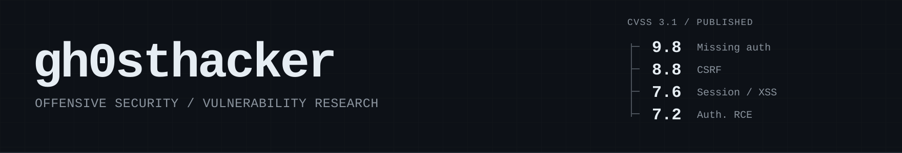

I find and responsibly disclose vulnerabilities in web applications. I build tooling to investigate captured application behaviour and evidence. I maintain graph-kb-assistant, a local-first graph over Caido HTTP captures.

<table><tr><td width="293">

### 4
`published advisories`

</td><td width="294">

### 6
`CVE requests filed`

</td><td width="293">

### 1
`open-source project`

</td></tr></table>

<table><tr><td width="740">

### [graph-kb-assistant](https://github.com/gh0sthacker/graph-kb-assistant)

</td><td width="140" align="right"></td>
</tr><tr><td colspan="2" width="880">

Local-first graph over Caido HTTP captures: Neo4j for relationships, SQLite for capture state, encrypted vault for raw exchanges, MCP so an agent can query it.

**Go · MIT · early alpha**

</td></tr></table>

### Vulnerability catalog

Published advisories (4)

found 2026-06-03 · NETAMS WNAM ≤ 1.6.4799 Published in FSTEC BDU · CVSS 3.1

[BDU:2026-08966](https://bdu.fstec.ru/vul/2026-08966) · CWE-306 · **CVSS 9.8** Unauthenticated admin access to the web UI.

[BDU:2026-08967](https://bdu.fstec.ru/vul/2026-08967) · CWE-917 / CWE-94 · **CVSS 7.2** Remote code execution through expression-language injection (authenticated).

[BDU:2026-08968](https://bdu.fstec.ru/vul/2026-08968) · CWE-1004 / CWE-79 · **CVSS 7.6** Session hijack and account takeover through a cookie without HttpOnly and XSS.

[BDU:2026-08969](https://bdu.fstec.ru/vul/2026-08969) · CWE-352 · **CVSS 8.8** State change as another user through cross-site request forgery.

CVE requests pending (6)

CVE requests submitted, IDs reserved, not yet public. No public CVE record yet; checked 2026-10-30.

1. `CAN-2026-2039690`
2. `CAN-2026-2039708`
3. `CAN-2026-2039709`
4. `CAN-2026-2039710`
5. `CAN-2026-2040557`
6. `CAN-2026-2040558`

Disclosure policy

1. Report only through the project’s documented channel: `/security`, `SECURITY.md`, email, GHSA, a private portal, or VDP/VRP.
2. If no private channel exists, or there is no reply for 30 days, a public issue may be opened **without a PoC**.
3. After acknowledgment, send at most two follow-ups, spaced weeks apart.
4. Allow up to 90 days for remediation, with an extension possible.
5. Public or CNA disclosure follows the fix, or 30 days of silence after the last substantive response.

Out of scope

1. DoS or volumetric testing without research value.
2. Self-XSS.
3. Clickjacking on non-sensitive pages.
4. Issues requiring privileges the reporter already has.
5. Missing security headers without demonstrable impact.
6. Theoretical issues without a working PoC.

Contact · [ghosthacker.security@gmail.com](mailto:ghosthacker.security@gmail.com) · [/security](https://github.com/gh0sthacker/gh0sthacker/security)
